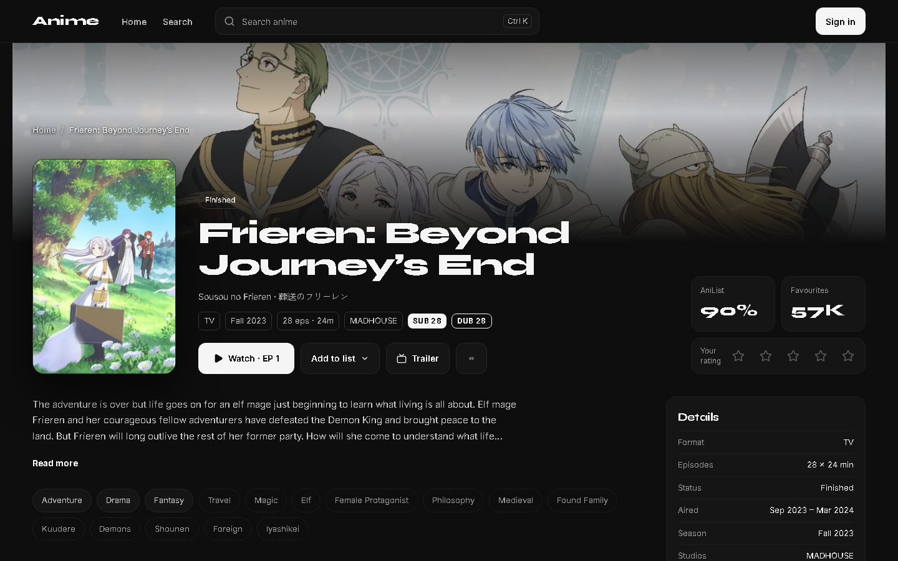
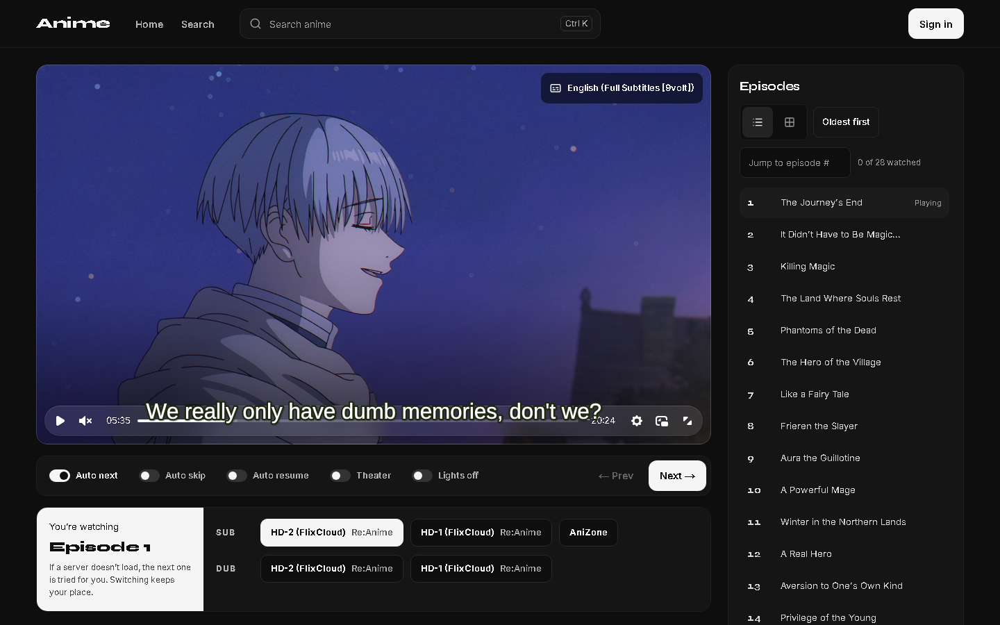

# thesupersuperanime.lol

[](https://discord.gg/trvtVNWzaf)


An anime streaming site built solo: AniList metadata, playback through
[RECONSUMΣT.TS](https://github.com/thesupersupersigma/RECONSUMET.TS), accounts and watch history. Anyone can host
their own copy: one `docker compose up -d` runs the site, its database and RECONSUMΣT.TS together, and every name,
link and login comes from your `.env`.

**Status: v0.6.0, the watch path.** Search for an anime, open its page (episodes, characters, watch order, your list
status and rating, trailer), press play and watch it: sub or dub, styled subtitles rendered exactly (libass through
JASSUB), automatic fallback when a server fails, resume, skip intro/outro, up next, theater mode and keyboard
shortcuts. Your progress is kept in your account, or in the browser as a guest. Underneath: accounts (email, Discord,
Google, GitHub, Microsoft, passkeys, two-step verification). The real Home and the Schedule come in 0.7. v1
(April–August 2026) is kept on the [`old`](../../tree/old) branch.

| Anime page | Watch page |
| --- | --- |
|  |  |

## Quick start

Needs Docker with the Compose plugin, on any x86-64 or arm64 Linux machine (or Docker Desktop).

```sh
git clone https://github.com/thesupersupersigma/thesupersuperanime.lol.git && cd thesupersuperanime.lol
cp .env.example .env
# set the four REQUIRED values in .env, each to its own: openssl rand -hex 32
docker compose up -d
```

Then open <http://localhost:3000>. The first run builds the site (a few minutes). Ports 3000 or 8081 already taken?
Set `SITE_PORT` / `RELAY_PORT` in `.env`.

Sign-in is off until you set up a method: see [docs/auth.md](docs/auth.md). Going public with HTTPS, email, every
setting, upgrades and backups: [docs/self-hosting.md](docs/self-hosting.md).

## Development

Node 26 + pnpm 11: `pnpm install`, then `pnpm dev` against any Postgres and RECONSUMΣT.TS
([details](docs/self-hosting.md#running-without-docker-development)). `pnpm lint`, `pnpm typecheck`, `pnpm test`,
`pnpm build`; end-to-end tests in [e2e/](e2e/README.md).

Stack: Next.js 16 (App Router, standalone, Node runtime), React 19, Tailwind CSS 4, Radix UI, Prisma 7 + PostgreSQL,
Better Auth 1.7, Video.js 10 + hls.js, JASSUB (libass), three.js, `@reconsumet/client`.

## Versioning

- `0.N.0` = the state after milestone N; `0.N.x` = small fixes in between.
- `1.0.0` = everything v1 had (streaming, discovery, community, profiles, notifications, admin), rebuilt properly.
- A release is a git tag `vX.Y.Z` matching the version in `package.json`; it publishes the Docker image.

## Community

Questions, bugs and ideas: the [Discord](https://discord.gg/trvtVNWzaf), or GitHub issues.

## License

GPL-3.0-or-later — see [LICENSE](LICENSE).
